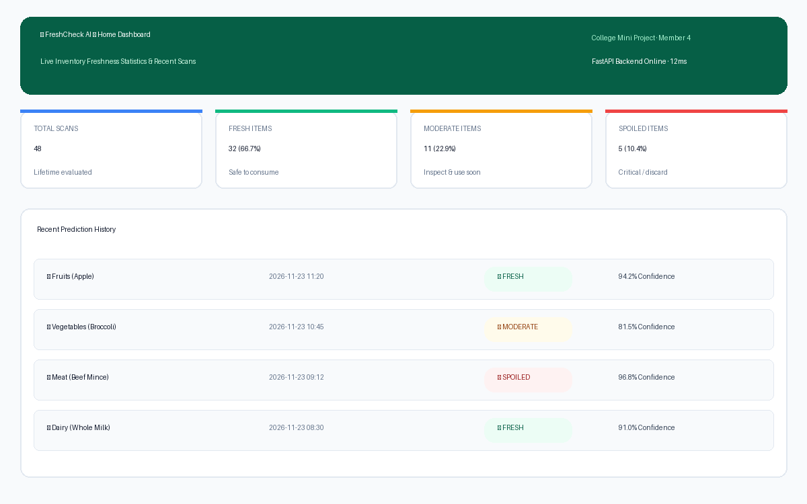
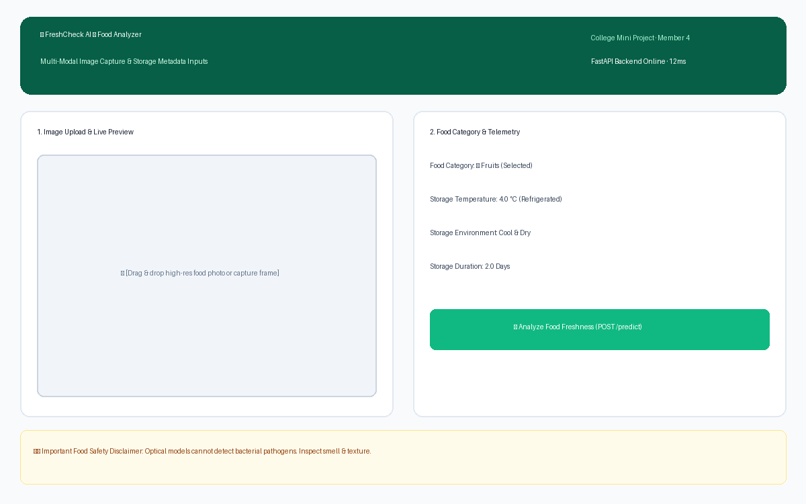
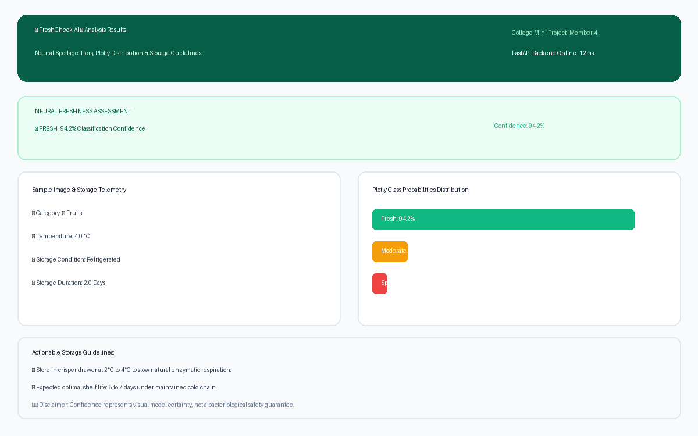
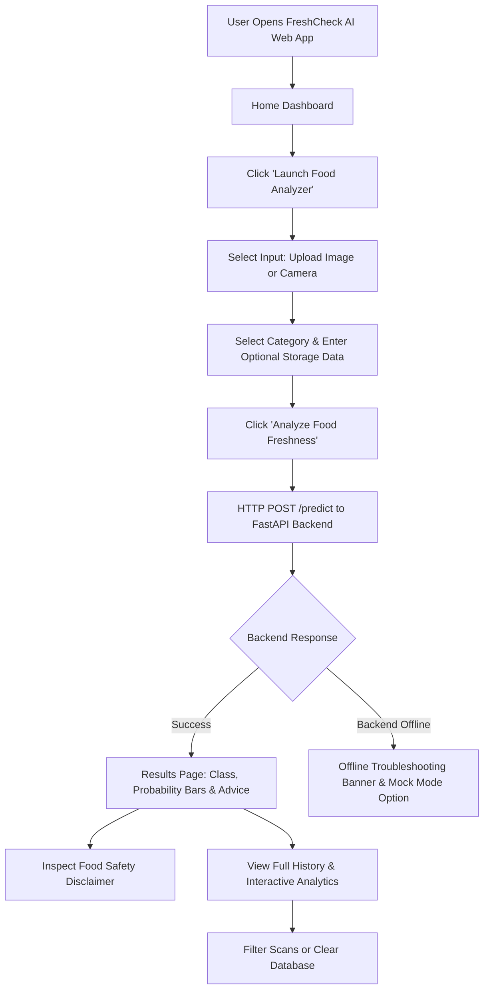

# 📸 FreshCheck AI — UI/UX Documentation & Screen Walkthrough

This document showcases the interface architecture, screen layout, user experience flows, and visual components designed by **Member 4 (Frontend Developer & UI/UX)** for **FreshCheck AI**.

---

## 🎨 Visual Identity & Color Palette
- **Fresh Tier**: `#10B981` (Emerald Green)
- **Moderate Tier**: `#F59E0B` (Warning Amber)
- **Spoiled Tier**: `#EF4444` (Critical Red)
- **Canvas & Neutral**: `#F8FAFC` (Canvas), `#FFFFFF` (Surface Cards), `#0F172A` (Typography)

---

## 🖥️ Screen Walkthrough

### 1. Home Dashboard (`frontend/views/dashboard.py`)

- **Hero Header**: Branding with project title, college team member attribution, and live backend connection badge.
- **Real-Time KPIs**: Total Scans, Fresh Items count (%), Moderate Items count (%), Spoiled Items count (%) computed dynamically from Member 3's `GET /history`.
- **Recent Activity**: Chronological list of previous evaluations with category icons, timestamp, status badge, and confidence rating.
- **Quick Action**: "🚀 Launch Food Analyzer" CTA for fast workflow initiation.

---

### 2. Food Freshness Analyzer (`frontend/views/analyzer.py`)

- **Multi-Modal Image Input**: Dual support for drag-and-drop file upload (`.jpg`, `.png`, `.webp`) and live camera frame capture (`st.camera_input`).
- **Food Category Dropdown**: Strict alignment with project taxonomy (`Fruits`, `Vegetables`, `Meat`, `Dairy`).
- **Environmental Telemetry**:
  - Storage temperature in Celsius (`-30.0°C` to `55.0°C`)
  - Storage condition (`Refrigerated`, `Room Temperature`, `Frozen`, `Cool & Dry`, `Pantry`)
  - Storage duration (Value + Days/Hours selector)
- **API Dispatch**: On clicking "🔍 Analyze Food Freshness", sends multipart payload to Member 3's `POST /predict`.

---

### 3. Neural Prediction Results (`frontend/views/results.py`)

- **Assessment Hero Banner**: Dynamic color-coded gradient highlighting predicted freshness tier.
- **Interactive Plotly Visualizations**:
  - Horizontal probability breakdown for all three classes (`Fresh`, `Moderate`, `Spoiled`).
  - Semi-circular confidence gauge meter.
- **Actionable Storage Guidelines**: Science-backed preservation, refrigeration, and culinary tips tailored to the food category and spoilage stage.
- **Explicit Food Safety Disclaimer**: Strict legal and academic notice emphasizing that optical predictions cannot confirm bacteriological safety.

---

### 4. Scan History & Analytics (`frontend/views/history.py`)
- **Interactive Donut Charts**: Category distribution and freshness tier breakdown.
- **Activity Timeline**: Chronological scatter plot of scanning trends.
- **Filterable Data Explorer**: Filter by category, freshness status, or keyword search.
- **Database Management**: One-click confirmation option to clear history via backend `DELETE /history`.

---

## 🔄 User Journey Diagram

